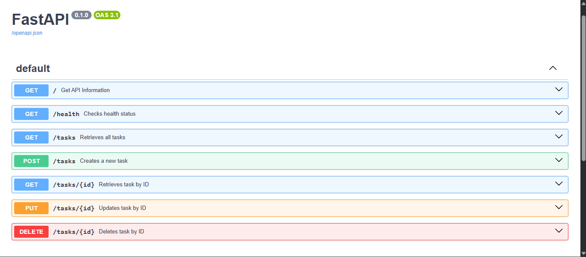

CRUD API Project

1. What this is:
CRUD API is a program that allows users to create, read, update, and delete tasks, hence the four main operations of CRUD. This particular program was built using the Python language and the FastAPI framework. Each task is stored in memory and contains an ID, title, and completion status (done). 

2. How to install and run it:
To get started, first install the standard FastAPI using the command in the terminal:
"pip install fastapi[standard]"
This installs what's needed to run the server, which after the download's done, run the following command from the project folder containing the file:
"python -m fastapi dev main.py"

The server will run at "http://localhost:8000/" and the interactive documentation is hosted at "http://localhost:8000/docs"

3. Endpoint Table

| Method | Endpoint      | Purpose              | Success Status |
|--------|---------------|----------------------|----------------|
| GET    | `/`           | Get API information  | 200            |
| GET    | `/health`     | Checks health status | 200            |
| GET    | `/tasks`      | Retrieves all tasks  | 200            |
| GET    | `/tasks/{id}` | Retrieves task by ID | 200            |
| POST   | `/tasks`      | Creates a new task   | 201            |
| PUT    | `/tasks/{id}` | Updates task by ID   | 200            |
| DELETE | `/tasks/{id}` | Deletes task by ID   | 204            |

Note: The API returns 400 for an invalid input and 404 when a task ID doesn't exist

4. Example:
Here is a curl example using the GET method with the endpoint "/tasks"
Command: "curl.exe -i http://localhost:8000/tasks"
Output:
HTTP/1.1 200 OK
date: Thu, 29 Oct 2026 08:24:07 GMT
server: uvicorn
content-length: 136
content-type: application/json

[{"id":1,"title":"Finish the book","done":false},{"id":2,"title":"Clean the room","done":true},{"id":3,"title":"Work out","done":false}]

5. Swagger:
This program can also be used interactively using the Swagger UI. It lists all the endpoints coded in as well as a user friendly interface to run the commands
